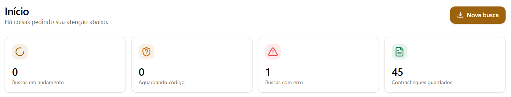
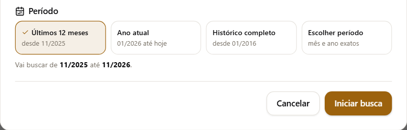
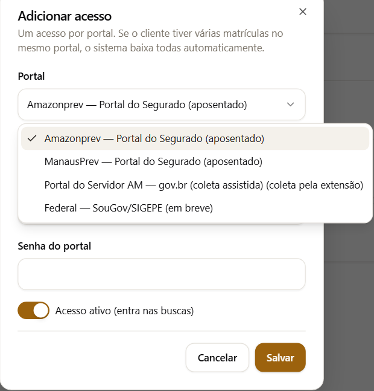
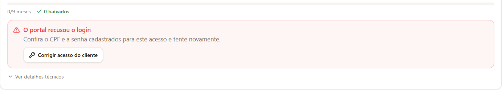
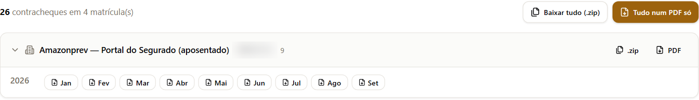
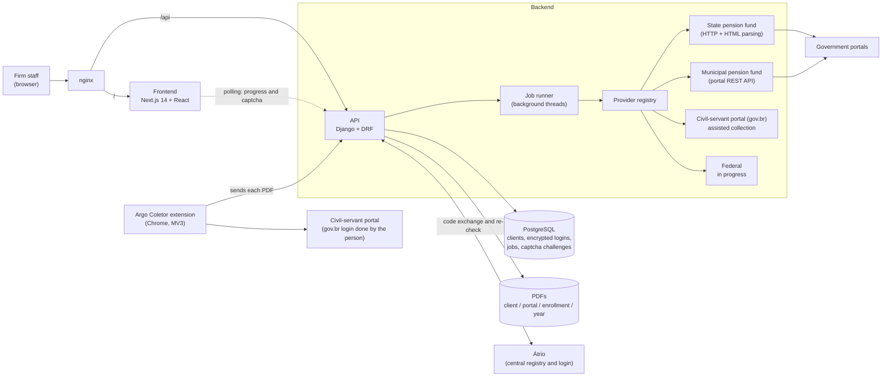
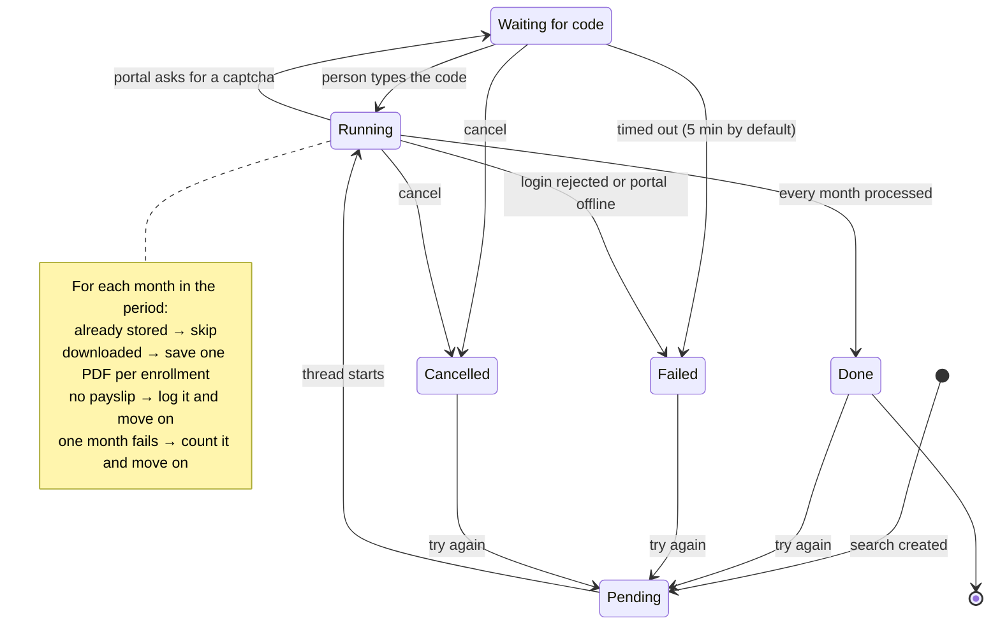
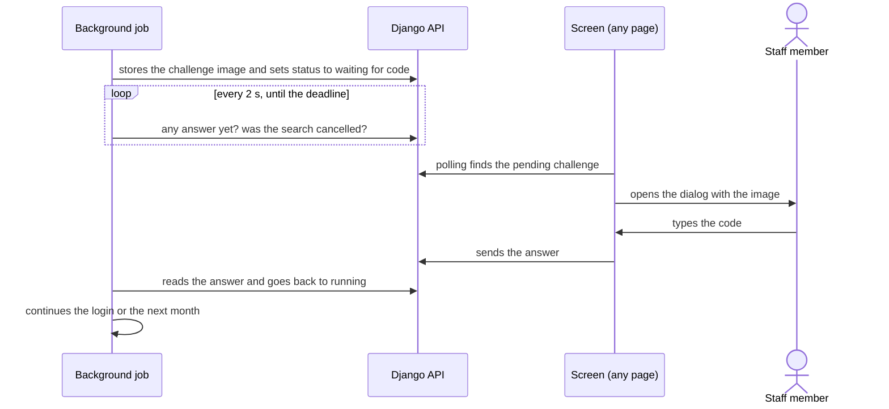

# Argo — payslips pulled from government portals, no manual work

🇧🇷 [Versão em português](README.md)

## Context

A law firm in Manaus, Brazil, represents many civil servants, retirees and pensioners, and almost every case starts with the client's payslips. Before Argo, someone on the team had to log into each government portal, one client and one month at a time, download the PDFs and file them by hand. Argo automates that: the team registers the client and their portal logins, picks a period, and the system fetches the payslips in the background. Files end up organized by client, portal, enrollment number and year. The project started as a command-line script that downloaded payslips from a single portal and grew into a multi-portal web system.

## Highlights

- **One provider per portal**: each government portal (state pension fund, municipal pension fund, state and city civil-servant portal, federal still in progress) has its own module behind a shared contract. Supporting a new portal means writing its module and registering it.
- **Background jobs**: each selected login becomes a job with per-month progress (downloaded, already on file, no payslip, failures). A job can be cancelled, and "Try again" redoes only what was missing.
- **Captcha with a human in the loop**: when a portal asks for a captcha, the job pauses and the image pops up in a dialog on whatever screen the user is on. The person types the code and the job resumes. If nobody answers in time (5 min by default), the job stops with a clear error.
- **Nothing is downloaded twice**: months already on file are skipped. A login with several enrollments (several benefits) gets one PDF per enrollment.
- **Downloads the way the team needs them**: a single month, a .zip per enrollment, a .zip of the whole client, or "everything in one PDF".
- **Assisted collection where bots aren't allowed**: the civil-servant portal only accepts gov.br (Brazil's federal single sign-on), which blocks automation. There, the person logs in in their own browser and the **Argo Coletor** extension walks the payslip screen and sends each PDF to the system.
- **Protected credentials**: portal passwords are encrypted with Fernet. PDFs are only served through the authenticated API, never directly by the web server.
- **Sign-in through the firm's central directory**: the team logs in with their account from the firm's central registry (Átrio). When someone's access is revoked there, their Argo session ends too.

## Screens

> Crops of real screenshots. Names, ID numbers and enrollment numbers were cropped out or blurred. The UI is in Portuguese.

| | |
|---|---|
|  |  |
| **Home**: searches running, waiting for a code (captcha), failed, and total payslips stored. | **New search**: one-click periods (last 12 months, this year, full history) or an exact month and year. |
|  |  |
| **One login per portal**: each provider shows its mode (automatic search, collection via the extension, or "coming soon"). | **Plain-language errors**: "the portal rejected the login", with a shortcut to fix it; technical details stay collapsed. |
|  | |
| **Client files**: grouped by portal and enrollment, with a .zip or a single PDF per group or for the whole client. | |

## Architecture

The frontend follows everything by polling: a single state provider at the app level checks active searches and, when a job asks for a captcha, opens the dialog wherever the person is. In production, nginx, frontend and backend run in Docker containers on a self-hosted server behind a Cloudflare Tunnel.

## Search lifecycle

## The captcha goes through a person

Because the job and the screen only talk through the database, the search keeps going even if the person switches pages, and the same mechanism works for any portal that asks for a captcha.

## Stack

| Layer | Technologies |
|---|---|
| Backend | Python, Django 6, Django REST Framework, SimpleJWT, gunicorn |
| Portal scraping | requests + BeautifulSoup, Playwright (for a portal that needs a browser session), pypdf |
| Frontend | Next.js 14 (App Router), React 18, TypeScript, Tailwind CSS, Radix UI, lucide-react |
| Extension | Chrome Manifest V3, JavaScript |
| Data | PostgreSQL (SQLite for local development), PDFs on a volume |
| Security | Fernet (cryptography) for portal passwords, short-lived JWT, sign-in via Átrio |
| Infra | Docker Compose, nginx, self-hosted server behind Cloudflare Tunnel |

## Technical decisions and challenges

- **The loop lives in the base class; a portal only knows how to fetch one month.** Each provider implements `login()` and `baixar_mes()` ("fetch month"). Counting, resuming, cancelling and persistence live in the base class, and a failed month is logged without killing the whole search. The return value can be a single PDF or a list per enrollment, which solved the case of retirees with several benefits under one login.
- **Jobs in threads, state in the database.** At the firm's volume, a queue with a broker would be extra weight. A job runs in a thread, writes every step to the database, and the UI reads it by polling. Cancellation is checked every month and while waiting for a captcha.
- **Plain HTTP whenever possible.** Login and lookup flows were mapped on the portals themselves, in one case by reading the web app's frontend bundle to find its REST API. A headless browser (Playwright) was kept only for the portal whose session required one. Searches are faster and break less.
- **Don't fight gov.br.** gov.br blocks automated logins. Instead of trying to get around that, collection became assisted: the person logs into the portal in their own browser and the extension does the repetitive part. When the extension has to show a saved password for the person to type, it only shows it to users with the right permission, hides it after 2 minutes, and logs every request.
- **Short, revocable sessions.** Sign-in through Átrio uses a single-use code that the backend exchanges with the system's API key, plus a `state` value that ties the redirect back to the request that started it. The Argo token lasts 15 minutes and every refresh re-checks with Átrio. An HMAC-signed notice ends the session within seconds when access is revoked.
- **Idempotency enforced by the database.** A uniqueness constraint on (login, enrollment, year, month) guarantees that repeating a search never duplicates files. There is also a pause between months so the government portals aren't hammered.

## My role

I wrote most of the commits in the repository (6 of 8, merges excluded). The initial commit, with the system's base, came from another team member. My commits delivered:

- sign-in through Átrio end to end (backend, login screens, refresh with re-checking, revocation notice and automated tests);
- the Argo Coletor extension and assisted collection for the civil-servant portal, including the endpoint that receives the collected PDFs;
- the extension's gov.br login panel, which shows the saved password only to authorized users;
- flagging in the UI the legacy portals that went offline;
- the production deploy and its documentation.

---

The source code of this project is private. This repository is only a showcase, with a description, diagrams and screenshots. Contact: [github.com/roger-mont](https://github.com/roger-mont)
