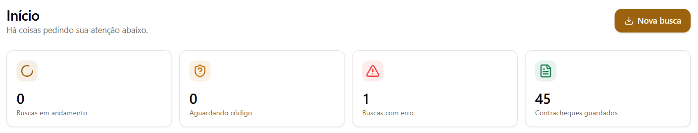
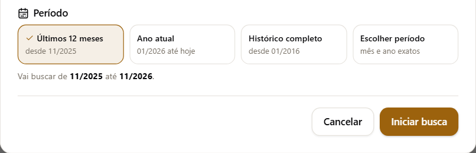
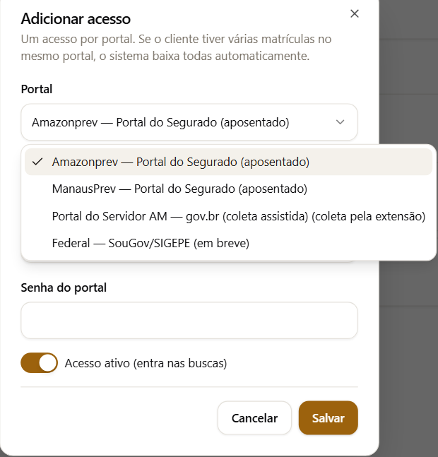
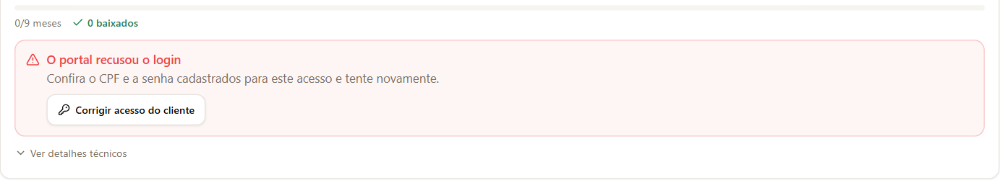
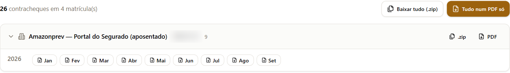
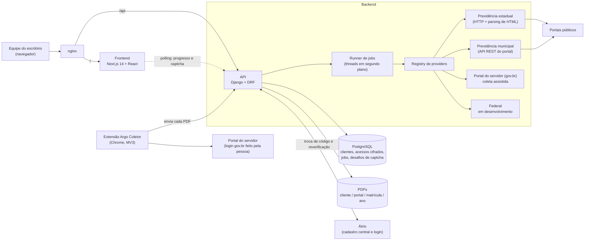
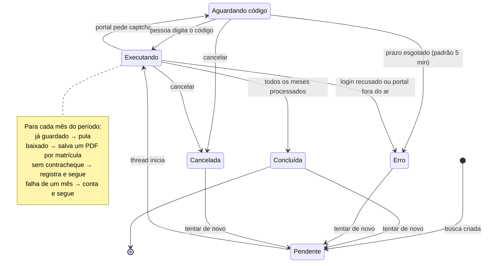
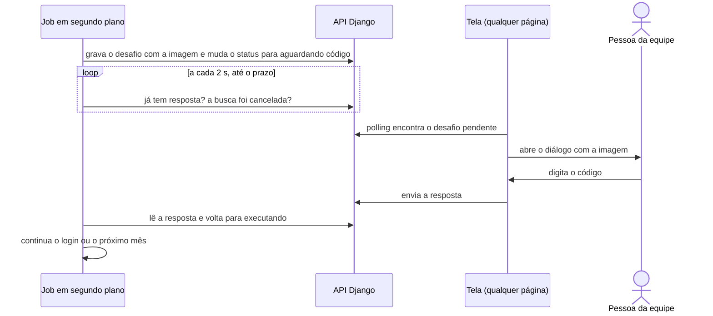

# Argo — contracheques baixados dos portais públicos, sem trabalho manual

🇺🇸 [English version](README.en.md)

## Contexto

Um escritório de advocacia em Manaus atende muitos servidores públicos, aposentados e pensionistas, e quase todo caso começa pelos contracheques do cliente. Antes, alguém da equipe entrava em cada portal público, um cliente por vez e um mês por vez, para baixar os PDFs e guardá-los à mão. O Argo automatiza isso: a equipe cadastra o cliente e os acessos dele aos portais, escolhe o período e o sistema busca os contracheques em segundo plano. Os arquivos ficam organizados por cliente, portal, matrícula e ano. O projeto nasceu de um script de linha de comando que baixava os contracheques de um único portal e virou um sistema web com vários portais.

## Destaques

- **Um provider por portal**: cada portal público (previdência estadual, previdência municipal, portal do servidor estadual e municipal, federal em desenvolvimento) tem o próprio módulo, com um contrato comum. Para incluir um portal novo, basta escrever o módulo dele e registrá-lo.
- **Buscas em segundo plano**: cada acesso selecionado vira um job com progresso por mês (baixados, já existentes, sem contracheque, falhas). A busca pode ser cancelada e, com "Tentar de novo", refaz só o que faltou.
- **Captcha com uma pessoa no circuito**: quando o portal pede captcha, o job pausa e a imagem aparece num diálogo, em qualquer tela do sistema. A pessoa digita o código e o job continua. Se ninguém responder dentro do prazo (5 min por padrão), o job para com um erro claro.
- **Nada é baixado duas vezes**: o mês que já está guardado é pulado. Um acesso com várias matrículas (vários benefícios) gera um PDF por matrícula.
- **Download como a equipe precisa**: um mês, o .zip de uma matrícula, o .zip do cliente inteiro ou "tudo num PDF só".
- **Coleta assistida onde robô não entra**: o portal do servidor só aceita login gov.br, que bloqueia automação. Nesse caso, a pessoa faz o login no próprio navegador e a extensão **Argo Coletor** percorre a tela de contracheques e envia cada PDF ao sistema.
- **Credenciais protegidas**: as senhas dos portais ficam cifradas com Fernet. Os PDFs só saem pela API autenticada, nunca direto pelo servidor web.
- **Login pelo cadastro central do escritório**: a equipe entra com a conta do sistema central de cadastro (Átrio). Quando o acesso de alguém é cortado lá, a sessão no Argo também cai.

## Telas

> Recortes de capturas reais do sistema. Nomes, documentos e matrículas ficaram de fora do recorte ou foram desfocados.

| | |
|---|---|
|  |  |
| **Início**: buscas em andamento, aguardando código (captcha), com erro e total de contracheques guardados. | **Nova busca**: período em um clique (12 meses, ano atual, histórico completo) ou mês e ano exatos. |
|  |  |
| **Acesso por portal**: cada provider aparece com o seu modo (busca automática, coleta pela extensão ou "em breve"). | **Erros em linguagem simples**: "o portal recusou o login", com atalho para corrigir o acesso; o detalhe técnico fica recolhido. |
|  | |
| **Arquivos do cliente**: agrupados por portal e matrícula, com .zip ou PDF único por grupo ou do cliente inteiro. | |

## Arquitetura

O frontend acompanha tudo por polling: um único provider de estado no app consulta as buscas ativas e, quando um job pede captcha, abre o diálogo onde a pessoa estiver. Em produção, nginx, frontend e backend rodam em containers Docker num servidor próprio, atrás de Cloudflare Tunnel.

## Ciclo de vida de uma busca

## O captcha passa por uma pessoa

Como o job e a tela conversam só pelo banco, a busca segue mesmo que a pessoa troque de página, e o mesmo mecanismo serve a qualquer portal que peça captcha.

## Stack

| Camada | Tecnologias |
|---|---|
| Backend | Python, Django 6, Django REST Framework, SimpleJWT, gunicorn |
| Coleta nos portais | requests + BeautifulSoup, Playwright (portal que exige sessão de navegador), pypdf |
| Frontend | Next.js 14 (App Router), React 18, TypeScript, Tailwind CSS, Radix UI, lucide-react |
| Extensão | Chrome Manifest V3, JavaScript |
| Dados | PostgreSQL (SQLite no desenvolvimento local), PDFs em volume |
| Segurança | Fernet (cryptography) para senhas dos portais, JWT curto, login pelo Átrio |
| Infra | Docker Compose, nginx, servidor próprio atrás de Cloudflare Tunnel |

## Decisões técnicas e desafios

- **O loop fica na base, o portal só sabe baixar um mês.** Cada provider implementa `login()` e `baixar_mes()`. Contagem, retomada, cancelamento e persistência ficam na classe base, e a falha de um mês é registrada sem derrubar a busca inteira. O retorno aceita um PDF ou uma lista por matrícula, o que resolveu o caso de aposentados com vários benefícios no mesmo acesso.
- **Jobs em threads, com o estado no banco.** Para o volume do escritório, uma fila com broker seria peso a mais. O job roda numa thread, grava cada passo no banco e a interface lê por polling. O cancelamento é conferido a cada mês e durante a espera do captcha.
- **HTTP direto sempre que possível.** Os fluxos de login e de consulta foram mapeados no próprio portal, e num dos casos lendo o frontend da aplicação para achar a API REST. Navegador headless (Playwright) ficou só para o portal cuja sessão exigia isso. Assim a busca fica mais rápida e quebra menos.
- **Não contornar o gov.br.** O login gov.br bloqueia automação. Em vez de tentar driblar isso, a coleta virou assistida: a pessoa entra no portal pelo próprio navegador e a extensão faz o trabalho repetitivo. Quando a extensão precisa mostrar a senha salva para a pessoa digitar, ela só aparece para quem tem permissão, some da tela em 2 minutos e cada pedido fica registrado no log.
- **Sessão curta e revogável.** O login pelo Átrio usa um código de uso único que o backend troca com a chave de API do sistema, com um `estado` que amarra a ida à volta. O token do Argo vale 15 minutos e, na renovação, o Átrio é consultado de novo. Um aviso assinado com HMAC derruba a sessão em segundos quando o acesso é cortado.
- **Idempotência por restrição no banco.** A unicidade (acesso, matrícula, ano, mês) garante que repetir uma busca nunca duplica arquivos. Há também uma pausa entre meses para não sobrecarregar os portais públicos.

## Meu papel

Sou o autor da maioria dos commits do repositório (6 de 8, sem contar merges). O commit inicial, com a base do sistema, foi feito por outro integrante da equipe. Os meus commits trouxeram:

- o login pelo Átrio de ponta a ponta (backend, telas de login, renovação com reverificação, aviso de revogação e testes automatizados);
- a extensão Argo Coletor e a coleta assistida do portal do servidor, incluindo o endpoint que recebe os PDFs coletados;
- o painel da extensão para o login gov.br, com a senha revelada só sob permissão;
- a sinalização na interface dos portais antigos que saíram do ar;
- o deploy em produção e a documentação de deploy.

---

O código-fonte deste projeto é privado. Este repositório é só uma vitrine, com descrição, diagramas e telas. Contato: [github.com/roger-mont](https://github.com/roger-mont)
